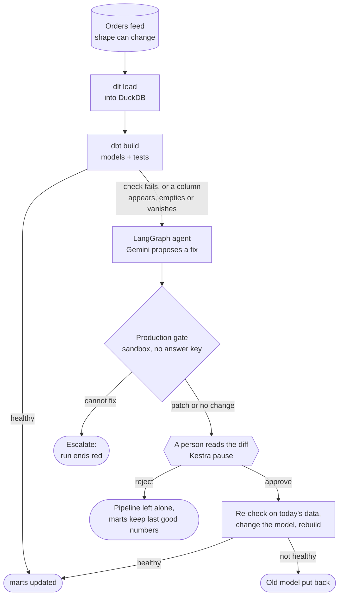
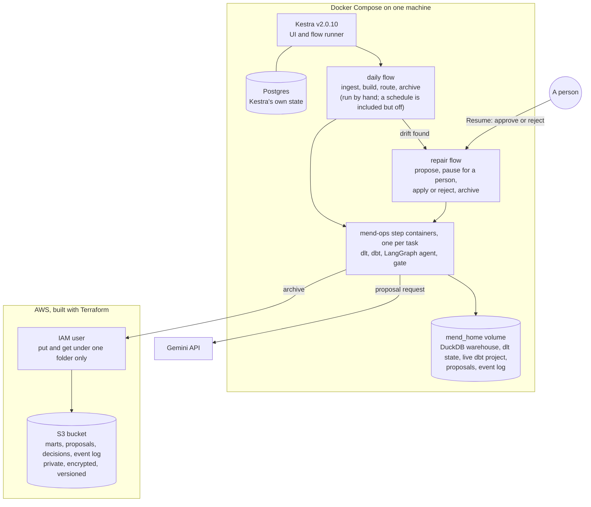
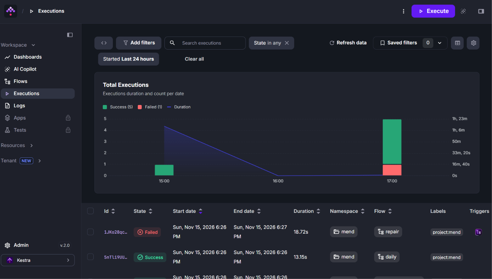

# Mend

[](https://github.com/Hemanth4994/Mend/actions/workflows/ci.yml)

Self-healing data pipelines. A daily dlt + dbt pipeline loads an orders feed into DuckDB. When the source changes shape without
warning, an agent proposes a fix to the dbt staging model, tests it in a sandbox, and a person approves it, rejects it, or the agent
escalates because it cannot be fixed. Every proposal waits for a person, because the evaluation found no kind of change that earns autonomy.

Status: **working end to end.** The evaluation is done (below), the pipeline runs under Kestra with Docker Compose and has been run end to end on a
laptop, and CI runs the tests and builds both Docker images. Design, stages and the full failure analysis are in [PLAN.md](PLAN.md).



## How it runs



Kestra starts a short-lived container from the `mend-ops` image for every step, and all of them share one volume that holds the warehouse, the live dbt project and the proposals. The `repair` flow pauses until a person chooses approve or reject. The S3 archive is optional: without a bucket the `archive` steps do nothing. The `bootstrap` and `source_change` flows only set up the demo.

## Result

60 source changes (30 dev, 30 test) run through real dlt and dbt, scored against an answer key, one run per configuration on code frozen before the
test split was touched (tag `frozen-v1`). Gemini 3.5 Flash-Lite, 2 attempts per case, a production gate with no access to the answer key.

| The agent is shown | Test: correct (95% interval) | Test: silent corruption |
|---|---|---|
| table schema only | 20 of 30 (49%-81%) | 1 |
| + failing checks, sample rows, schema signals | 26 of 30 (70%-95%) | 2 |
| + the source's release note | 27 of 30 (74%-97%) | 1 |

- Showing the evidence is what makes repair possible (dev and test together: 65% with schema only, 93% with evidence).
- All the silent corruptions are about time: IST local time with no offset, day-first dates. No check that runs in production can see them.
- No category earns autonomy: with 5-7 cases per category, even zero errors leaves an upper bound far above the 5% limit (52 clean decisions are needed).
  So everything waits for approval, and a patch on a timestamp column should wait whatever the statistics say.
- Limits: synthetic data written by the same author as the answer key, one run per configuration, one small model, 30 cases. Details and the failure
  analysis are in [PLAN.md](PLAN.md); one case (`v04`) had to be re-run after a Windows-only infrastructure fault, declared there.

## What ran for real

Kestra v2.0.10 and Docker Desktop on a Windows laptop, using Gemini for the proposals ([how to run it](orchestration/README.md)):

- **`rename_amount`**: the source renamed `amount` to `total_amount`. dbt's `not_null` check failed and the marts kept the last good day. The agent proposed
  `coalesce(amount, total_amount)`, every gate check passed, the run paused, a person approved, the patch was re-checked on that day's data and applied,
  and the marts recovered. The next day's load came out healthy.
- **`drop_city`**: the source stopped sending `city`. The agent escalated (no patch can bring the data back), the run ended red, and nothing was changed.



What this is not: one run of each case on one machine by the person who wrote it. The schedule has never been left on, and the
evaluation numbers above come from the 60-case benchmark, not from these runs. A 2-minute demo script and likely interview questions are in [docs/DEMO.md](docs/DEMO.md).

## What exists today

- `src/mend/feed.py`: the orders feed, deterministic.
- `src/mend/drifts.py`: 60 source changes (renames, nesting, units, formats, recoded values, dropped columns, harmless additions).
- `eval/cases.json`: 60 cases, 30 dev and 30 test.
- `src/mend/gold.py`: a hand-written correct repair for each of the 36 repairable cases (the agent never sees it).
- `src/mend/sandbox.py`: builds a case with real dlt, runs a staging model, compares with the answer key.
- `dbt/mend_dbt/`: staging and mart models with data tests.
- `src/mend/evidence.py`, `src/mend/validate.py`: what the agent is shown, and the production gate that judges its patch (no answer key).
- `src/mend/scoring.py`, `scripts/run_eval.py`: scores every decision against the answer key (silent corruption is the headline number) and runs a split,
  resuming where it stopped. The test split is refused unless the tag `frozen-v1` exists and the frozen folders match it.
- `results/{dev,test}_{schema,evidence,notes}_gemini.jsonl`: one run per configuration and split with Gemini, one row per case. `results/infra/` holds two rows set aside for an infrastructure fault; `seed/` the database that replaced the broken one.
- `scripts/standins.py`: an oracle, a lazy and an always-escalate stand-in, to measure the gate without an API key (`results/dev_evidence_*.jsonl`).
- `src/mend/agent.py`: the LangGraph repair agent (gather, propose, gate, one repair, then patch, no_change or escalate). The model is an injected
  function, so the graph is tested with a scripted stand-in and no API key (`tests/test_agent.py`).
- `orchestration/`: the live pipeline. `mend_ops.py` (ingest, build, repair, apply, reject, with a lock and an undo), four Kestra flows (daily run, repair with an approval pause, a bootstrap, a demo source change), a Dockerfile and a Compose file. Every proposal waits for a person. An optional `archive` step copies the marts and the approval records to S3.
- `infra/`: Terraform for that S3 archive: a private, encrypted, versioned bucket, an IAM user that can only put and get under one folder, and a budget alarm. Tested against a fake S3 and CI-validated, then applied to a real free-plan AWS project (10 resources, budget included); a Kestra `daily` run has uploaded files to that bucket as the write-only user ([runbook](infra/README.md)).
- `scripts/baseline_report.py`: runs every case through the unrepaired pipeline. Result: 34 break loudly, 11 pass every test with wrong
  numbers but show a schema change, 1 is invisible to every check, and the 14 harmless ones are all absorbed by dlt.

## Run it

```bash
pip install -c constraints.txt -e ".[agent,dev]"
python -m pytest                       # 275 tests, about nine minutes (56 of them are the orchestration tests); no API key or Docker needed
python scripts/baseline_report.py      # all 60 cases through dlt and dbt, about two minutes
```

The versions in `constraints.txt` matter: dlt's handling of schema changes differs between versions.

The Kestra version (Docker Desktop; the UI opens on http://localhost:8080 unless you set `MEND_KESTRA_PORT`):

```bash
python orchestration/make_env.py       # asks for a login, and optionally your Gemini key (not echoed); writes orchestration/.env, never committed
docker compose -f orchestration/docker-compose.yml --env-file orchestration/.env up -d --build
```

The S3 archive is optional and off until you build `infra/` and give `make_env.py` the bucket. Without a Gemini key everything runs except the model call. [orchestration/README.md](orchestration/README.md) has the demo order, the Windows notes and what to check if the first run fails.
